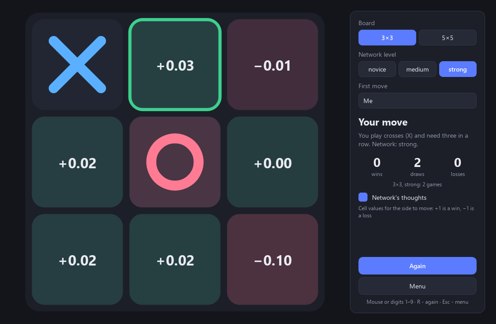

<div align="center">

# Tic-Tac-Toe vs a Neural Network

**You play against a neural network that was never told a single strategy. It taught itself by playing tens of thousands of games against itself, looking only at who won.**

[Download for Windows](https://github.com/ALEXalesha/TicTacToeAi/releases/latest) &nbsp;·&nbsp; [Русская версия этого файла](README.ru.md)

[](#) [](https://github.com/ALEXalesha/TicTacToeAi/releases/latest) [](https://github.com/ALEXalesha/TicTacToeAi/actions/workflows/ci.yml) [](LICENSE) [](https://www.python.org/) [](https://doc.qt.io/qtforpython-6/) [](https://claude.com/claude-code)

Code, tests and docs are written by Claude (Anthropic) in Claude Code. Ideas, testing and decisions - Alexey.



</div>

> **The interface speaks English and Russian** (Settings → Language, switches on the fly). The long write-up is in Russian - [README.ru.md](README.ru.md), which this file summarises.

## Two boards, three levels

- **3×3, three in a row** - classic tic-tac-toe. The strong network never loses here, and that is checked by exhaustive search over every possible opponent move, not just by sampling games.
- **5×5, four in a row** - a much harder game, where you can see how far the network got.

Each board has three levels - novice, medium and strong. They are snapshots of one training run: early, midway and at the end.

The rules (whose move, is the cell free, who completed a line, draw) are ordinary code. The network does not know them; it only evaluates positions.

## How the network plays

It scores the position **after a move** - "what happens if I go here". To move, it tries every free cell and picks the highest score. Switch on "thoughts" and you see exactly these scores, from −1 (I lose) to +1 (I win), coloured in each cell.

The input is the board seen by the player who just moved: two 0/1 planes, "my stones" and "their stones", so one network plays both X and O. The output is a single tanh value.

| Board | Network | Weights |
|---|---|---|
| 3×3 | dense 18 → 64 → 64 → 1 | 5,441 |
| 5×5 | 3×3 convolutions 2 → 32 → 32 → 32, then dense 64 → 1 | 70,433 |

No PyTorch: layers, backpropagation and Adam are written in numpy, and every gradient is checked against a numerical one in the tests.

## How it learned

Self-play, 64 games at a time, with a share of random moves falling from 30 % to 5 %. After each batch every position gets a TD(λ) target (λ = 0.7): a blend of the best reply the opponent had and how the game actually ended, discounted per move so quick wins count more. A random reply cuts the trace. The "best reply" is 10 % averaged over all replies, so among equally drawn moves the network prefers the one where a weaker opponent is more likely to slip. Every position is augmented into 8 by rotations and reflections.

3×3 took 30,000 games and 11 seconds; 5×5 took 40,000 games and 12 minutes (4 CPU threads).

## Results

200 games per check, half of them with the network moving first. Numbers are wins / draws / losses for the network.

| | vs random | vs "win or block" bot | vs minimax |
|---|---|---|---|
| 3×3 novice | 125 / 9 / 66 | 11 / 29 / 160 | 0 / 26 / 174 |
| 3×3 strong | 193 / 7 / 0 | 61 / 139 / 0 | **0 / 200 / 0** |
| 5×5 novice | 174 / 1 / 25 | 41 / 10 / 149 | - |
| 5×5 strong | 200 / 0 / 0 | **183 / 6 / 11** | - |

Moving first against a random player, the strong 3×3 network wins 98.5 %. On 5×5 the "win or block" bot always blocks a single threat, so beating it takes a fork - two threats at once. The strong network learned that on its own and wins 91.5 % of those games.

All numbers are stored in the model passports `game/models/3x3.json` and `game/models/5x5.json`, together with the learning curve; the tests recompute every check with the same seeds and compare game for game.

## Running it

Windows builds - an installer and a portable zip, with Python, numpy and Qt inside - are on the [releases page](https://github.com/ALEXalesha/TicTacToeAi/releases/latest).

From source (Python 3.11+):

```
pip install -r requirements.txt
python main.py
```

Retrain: `python -m game.train.selfplay --size 3` (or `--size 5`). Headless self-check: `python main.py --selftest result.txt`. Build: `python build.py` (needs PyInstaller, Pillow and NSIS).

## Part of AiGameRoom

Since 1.1.0 the game follows the [PythonAiGames contract](https://github.com/ALEXalesha/AiGameRoom): everything game-specific lives in `game/`, and `game/__init__.py` exports `GAME_INFO` and `create_widget(ctx)`. The game has no main window of its own: `python main.py` puts the widget into a small standalone window (`aikit.make_window`), and the AiGameRoom shell puts the very same widget into a tab. Theme, language and volume come from `ctx` and change on the fly; files are written only to `ctx.data_dir` (`%APPDATA%\TicTacToeAi\tictactoe` for the standalone game). Settings and statistics of 1.0.x (`%LOCALAPPDATA%\TicTacToeAi`) are copied over on the first start; the old files stay where they were.

| Folder | What it does |
|---|---|
| `game/core/` | rules and test bots, no Qt |
| `game/ai/` | the value network, symmetries, loading trained models |
| `game/train/` | self-play training |
| `game/ui/` | the Qt widget: pages, board, chart, themes, sounds, English and Russian strings |
| `game/models/` | trained weights and passports |
| `aikit/` | shared kit of all AiGameRoom games: numpy layers, context, standalone window, settings, statistics, window state |

## Tests

```
python -m pytest
```

271 tests (180 of the game and 91 of the shared `aikit` kit), about four minutes: layer gradients, rules on both boards, symmetries, TD(λ) targets, the trained models against their passports, the whole window driven without a screen (Qt offscreen), and the contract entry point - the widget made the way the shell makes it, theme and language switched on the fly, pause/resume/shutdown, files written only to the data folder, every page in English with no Russian left. A mutation check broke the code on purpose eight times - win rule, gradients, saving statistics, the network's move choice, the training target - and the tests went red every time.

## Stack

Python · NumPy · PySide6 (Qt 6) · PyInstaller · NSIS

## Licence

MIT, see [LICENSE](LICENSE).
